# Quickstart Guide

km2 City Builder is an editor to create custom cities for videogames. Roads, intersections, terrain, buildings and props are placed and edited interactively, then the city is exported in the format of the target game.

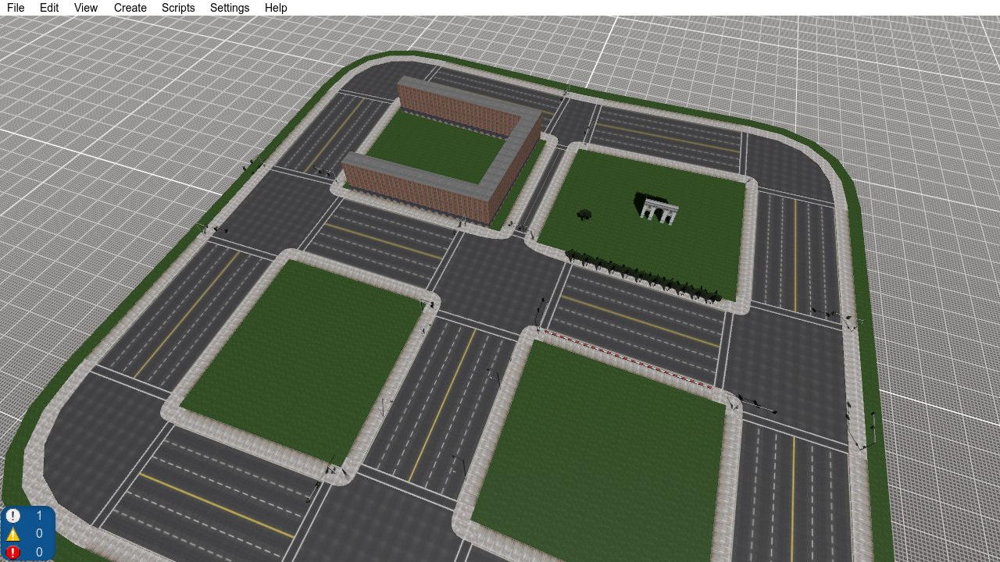

## Overview

### Cores

The editor itself knows nothing about any game: support for each game is added by a *core*, which defines (in json files and Python code) which elements are available and what parameters they have, how their geometry is generated, how textures and meshes are read, and how the city is exported. Other features can be added by each core, see the *Readme* file of the core you use for more info.

### Typical workflow

1. Create a city for the chosen core, and optionally import a heightmap and a reference image for the ground.
2. Place the roads. Intersections are created automatically where roads are connected.
3. Fill the space between the roads with terrain patches (*Create→Whole city terrain* does it in one step).
4. Add the buildings, either procedurally generated (building lines, *Create→Whole city buildings* fills the whole city) or as pre-made meshes.
5. Add props (by hand or with prop rules on the roads) and set the city-wide properties.
6. Save, then export the city for the game.

Try to finish the road network before placing terrain patches: changing the topology of the roads afterwards (e.g. deleting or reconnecting roads) can disconnect the terrain from them, and the involved patches will have to be recreated.

## Setup

### Python

Python 3 is required to use the city builder. You can let the city builder manage its own Python installation, in this case the packages required by the cores are installed automatically. Alternatively you can use your own installation by setting its path in *Settings→Preferences→Python*, in that case you will have to install the packages required by the cores by yourself. The same tab also contains the port of the local Python server and its debug mode (see [Troubleshooting](#troubleshooting)).

### Installing cores

After launching the city builder for the first time you have to install at least one core: go to *Settings→Preferences→Cores*, select one of the listed cores and click *Install*. A list of known core repositories is included with the city builder, other cores can be added with *Add from repository* and their Git repository URL. From the same tab you can also uninstall cores, check for updates, and open the folder of a core.

Cores can only be managed while no city is loaded (to close the current city select *File→Close city*).

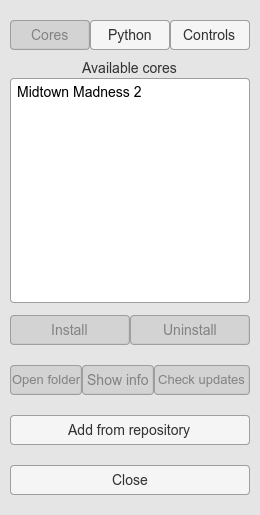

### Stock assets and search paths

The editor looks for textures and meshes in the city folder, and in any additional path you add in *Edit→Project settings→Paths*:

- *Global paths* are used for all cities
- *Local paths* are used for the current city only

Paths starting with a dot are relative to the *Files/common* folder in the city builder folder. If you want to use the stock meshes and textures of the game you are creating the city for, the usual place for them is *Files/common/\<core name\>*, as the city templates of a core may already include a local path pointing there.

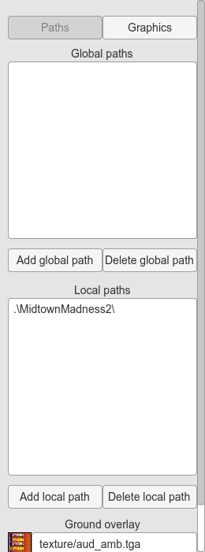

The supported texture formats are .bmp, .jpg, .png, .tga and .dds, the supported mesh format is .obj. Cores can add support for more mesh and texture formats (e.g. the native formats of the game) via Python scripting.

If you add files to the folders while the editor is open, click *Rescan folders* in the mesh list to see them.

## Your first city

### Creating a city

1. Select *File→New city* (if no city is loaded, the creation panel is already open on the right side of the window).
2. Choose the heightmap resolution, the terrain size (in meters) and the maximum height of the terrain (in meters). 4096 for both the resolution and the size is good for an average sized city.
3. Choose the core and a template. Each template includes its own presets.
4. Click *Select directory and create*, and create and select an empty folder for the city.

The (empty) city is then loaded.

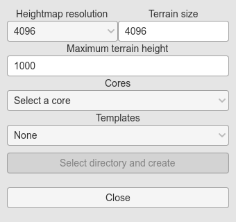

### Saving, loading and closing

- To save the city, select *File→Save city*, or press Ctrl+S.
- To load a city, select *File→Load city* and select the folder containing it. The last city opened is loaded automatically at startup.
- To discard all the changes made since the last save, select *File→Reload city*.
- To close the current city, select *File→Close city*.

Everything about a city is stored in its folder: the city itself (*city.json.gz*), its presets (*presets.json*) and its project settings (*preferences.json*), along with the textures and meshes you placed there. Copying the folder is enough to back up a city (the textures and meshes found through the other search paths are not included).

Exporting the city for the game is described in [Exporting](#exporting).

## Navigating and editing

### Camera

There are two camera control schemes, selectable in *Settings→Preferences→Controls*.

**Scheme A** (default):

| **Action** | **Mouse** | **Keyboard** |
|---|---|---|
| Pan | Drag with the middle button | Hold Home and move the mouse |
| Rotate | Drag with the right button | |
| Zoom | Scroll wheel | Page Up / Page Down |
| Zoom in on a point | Click the middle button without dragging | |

**Scheme B**:

| **Action** | **Mouse** | **Keyboard** |
|---|---|---|
| Orbit | Drag with the middle button | |
| Pan | Drag with the middle button holding Shift, or Ctrl/Shift + scroll wheel | Hold Home and move the mouse |
| Zoom | Scroll wheel, or drag with the middle button holding Ctrl | Page Up / Page Down |
| Zoom in on a point | Click the middle button without dragging | |

In scheme B the camera orbits around the point in the center of the view, and zooms toward it.

If your mouse has no middle button (e.g. on a laptop), enable *Emulate 3-button mouse* in the same tab: holding Alt while pressing the left button then acts as the middle button, in both schemes.

You can also jump to an object with *Zoom to object* in the object list (*Edit→View object list*).

### Selecting and deleting objects

- To select an object, click on it, or select it in the object list (*Edit→View object list*, it is highlighted) and click *Edit object*.
- To deselect it, click *End editing* or press Escape.
- To delete it, click *Delete* or press the Delete key. The Delete key also deletes the selected control point.
- If a mesh is in the way when clicking on another object, hold Ctrl to click through it.

The selected object is edited in the panel on the right side of the window. Most panels have several tabs, shown as buttons at the top of the panel.

### Placement modes

Objects made of points (roads, terrain patches and building lines) have a *Point placement mode* dropdown:

- *None*: no points are added, you can click on the existing points to select and move them
- *Add*: clicking on the ground adds a point at the end
- other modes depend on the object type (e.g. *Insert after selected* and *Split road* for roads, *Internal* for terrain patches, *Dividing point* for building lines)

New objects start in *Add* mode; when an existing object is selected again the mode is *None*.

Points are kept on the ground by default. Hold Shift while placing them to snap them to the grid.

### Moving points and objects

Select a point (or a mesh) and drag the gizmo, or press M and enter the new position by hand. To select more than one control point at a time, hold Ctrl while clicking (Ctrl-clicking a selected point unselects it).

While a road is edited, its ends on intersections are shown as big points in place of the points of the intersections: moving one of them moves the intersection, and the other roads connected to it follow.

### Rotating road sections

The sections of a road are normally perpendicular to its curve and level. A control point can rotate them: select it, press M, and enter its *Yaw* and *Roll* in degrees (up to 75), or click *Rotate* and drag the gizmo, whose axes follow the direction of the road at the point (*Move* goes back to moving it).

- *Yaw* turns the sections around the vertical axis (positive to the right). The road keeps its width, only its cut is skewed.
- *Roll* banks the sections (positive raises the right side, looking along the road).

The rotation blends along the curve from point to point, and a road type can disable either rotation (the MM2 PSDL roads can't be banked). At an intersection:

- A yawed end is cut skewed, for example along the edge of a road crossing at an angle: the intersection keeps the edges of the road and moves its corners along them. The yaw of an end on an intersection is limited to 60 degrees.
- A banked road counts as narrower (its width on the ground), and the intersection only moves its vertices up and down to follow it.
- A road normally ends at the height of the intersection point. Its *Connection height* (in the *Inters.* tab of the road, for the start and the end) raises or lowers its end. With *Auto* the end takes the height of the other roads there (the plane through their ends, plus the value set): use it for a road joining a banked road, otherwise the intersection gets steep between them.

### Keyboard shortcuts

| **Shortcut** | **Action** |
|---|---|
| Ctrl+R | Create a road |
| Ctrl+T | Create a terrain patch |
| Ctrl+E | Create a building line |
| Ctrl+S | Save the city |
| Ctrl+Z / Ctrl+Y | Undo / redo |
| Escape | End editing (deselect the object and close its panel) |
| Delete | Delete the selected object or point |
| M | Enter the position of the selected point or object by hand |
| W / E / R | Move / rotate / scale the selected mesh |
| Hold Shift | Snap to the grid, transform in incremental steps |
| Hold Ctrl | Select multiple control points, click through meshes |
| Up / Down | Navigate the lists (meshes, objects, ...) |

## Ground and reference images

The ground grid is a placement aid only, and is not exported: the actual terrain is made of [terrain patches](#terrain-patches), which follow the shape of the grid.

### Importing a heightmap

1. Place the heightmap (preferably a grayscale PNG) in the city folder.
2. Select *Edit→Load heightmap* and set the *Y scale*, i.e. the height (in meters) of the highest possible point (a white pixel in the heightmap).
3. Click on the white square under *Grayscale heightmap* and select the heightmap from the textures list.
4. Click *Load*.

### Editing the ground by hand

Select *Edit→Toggle terrain edit menu*, choose a *Terrain modifier* (*Raise terrain*, *Lower terrain* or *Level terrain*), set its *Intensity* and *Range*, then click (or click and drag) on the ground. When leveling, *Level to height* levels the ground to the given *Height* instead of the height of the point clicked first. If *Continuous* is unchecked, the modifier is applied once per click instead of continuously while holding the mouse button.

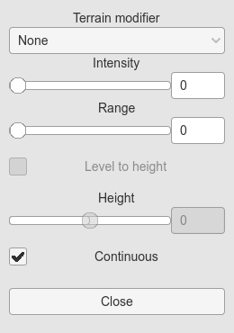

### Ground overlay

You can display an image on the ground as a guide for placing roads (e.g. a map of the real city): copy it in the city folder, select it in the *Ground overlay* field of *Edit→Project settings*, then enable it with *View→Toggle ground overlay*. Its opacity can be changed with *View→Change overlay transparency*.

### View options

- *View→Show all traffic lanes* shows the traffic lanes of all the roads.
- *View→Toggle ground only view mode* hides everything except the ground, which is useful while editing it.
- *View→Toggle wireframe* shows the meshes as wireframe, on a plain background.
- *View→Reset window* restores the default window size.
- The rendering mode, the shadows and the props culling distance are in *Edit→Project settings→Graphics*.

## Presets

Every object type has presets, which store a set of property values to reuse. The preset controls are near the top of the panel of each object:

- Select a preset from the dropdown to load it into the selected object. The object is then *linked* to the preset, and the last selected preset is also used for new objects of the same type.
- *Save preset* saves the current values as a new preset (or overwrites an existing one with the same name).
- *Reset* restores the values of the linked preset, discarding the changes made to the object.
- *Sync* assigns the linked preset to all the objects linked to it. Use it after saving the modified object over its preset to update all the others.
- *Unlink* removes the link, keeping the current values.

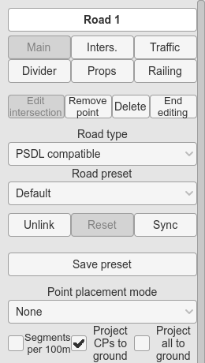

To edit the presets directly, select *Edit→Manage presets* and then the type of preset. In this mode the panel also has a *Delete preset* button, and the properties specific to a single object (e.g. the block number) are grayed out, as they are not part of the preset. The default preset cannot be deleted.

Presets are saved in the city folder (*presets.json*) as soon as they are saved or deleted, independently of saving the city.

## Roads and intersections

### Roads

To create a road, select *Create→Road* (or press Ctrl+R), then click on the ground to place its control points.

The control points describe a curve: a Bézier curve by default, it can be changed to a Hermite spline or to a low poly spline in *Spline type*. Low poly splines behave like Hermite splines but are optimized for low poly roads: with them, the number of segments is automatically set to the number of control points.

To keep the control points away from the ground, uncheck *Project CPs to ground*.

To add more control points to an existing road, select *Add* in the placement mode dropdown (or *Insert after selected* to insert new points after the selected one). To move the control points, set the placement mode to *None* and drag them.

The road properties are divided in several tabs (*Main*, *Inters.*, *Traffic*, *Divider*, *Props*, ..., depending on the core).

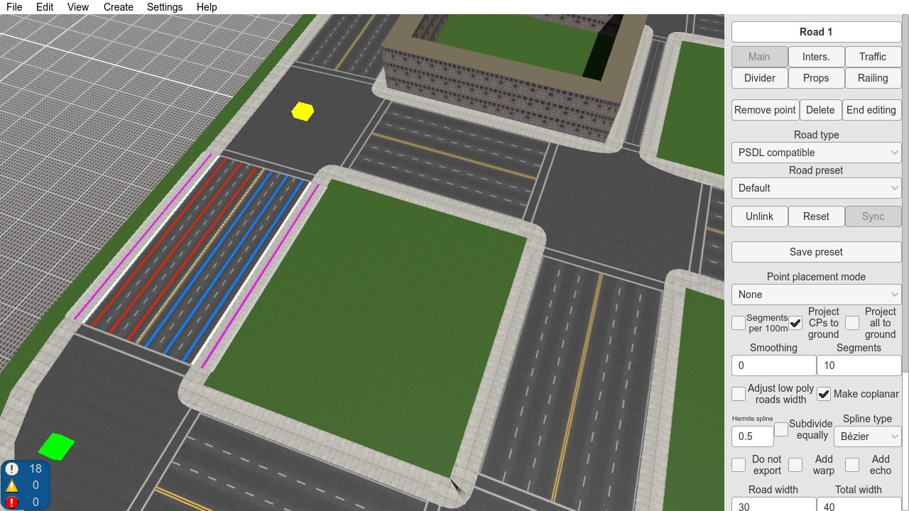

### Intersections

To create an intersection, connect two or more roads: place the first or the last control point of a road on the end of another road (the available ones are highlighted in cyan).

A road can also be connected to the middle of another road: while placing points, the other roads are highlighted with a cyan line along them. Placing the first or the last control point on that line creates an intersection there, and splits the other road in two roads with the same properties (if it is the first point, this happens when the second point is placed). Note that the two roads created by the splitting might have improperly placed control points causing malformed shapes (especially when splitting a Hermite spline road), if this happens simply remove the offending control points (usually the ones close to the intersection or close to the ends).

To split a road without connecting another road to it, select *Split road* in the placement mode dropdown of the road: the road is highlighted with a cyan line along it, and clicking on the line splits it there in two roads with the same properties, connected by a new seamless intersection (see below). The editor stays on the first part. The control points can still be selected and moved in this mode.

To edit an intersection, click on it (or select it in the object list).

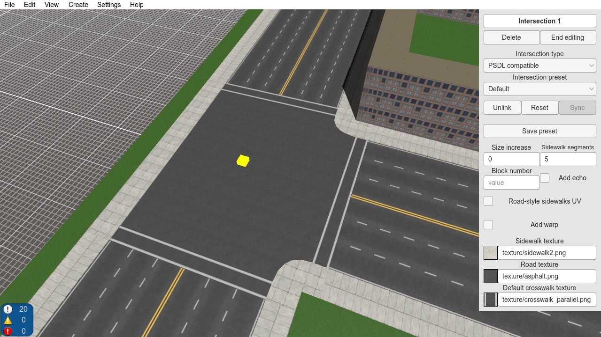

An intersection connecting exactly two roads can be removed by merging the two roads into one, for example to undo a split: click *Merge into* followed by the name of the road whose properties are kept. The end of the merged road takes the end properties of the other road (crosswalk size, connection height, roads through the intersection...). If the two roads go opposite ways, the other road is reversed, but only its shape: its left and right properties (sidewalks, lanes...) are not swapped. The merged road keeps the curve type of the kept road. Roads with the same curve are joined exactly: Hermite and low-poly roads by joining their control points (the shape near the old intersection may change slightly, since the control points a split removed there are lost), two Bézier roads that are the two parts of the same curve (as after a split) get its control points back, and two straight roads in line become a straight road again. Otherwise the merge is a best effort: two other Bézier roads become a single Bézier curve as close as possible to both (two straight roads at a corner become a curve rounding the corner), and a road with another curve is followed by new control points of a Hermite or low-poly road (within half a meter, or a quarter of a meter for low-poly).

Terrain points anchored to the merged roads stay in place but are no longer anchored, as after a split.

Two roads can also stay separate but join without an intersection between them: check *Seamless* in the editor of an intersection with exactly two roads (an intersection made by *Split road* already is). The intersection then has no surface, no crosswalks and no size, and the two roads go on from each other: their ends take the same direction, between the directions the roads have there, so the curve goes smoothly through the joint (a Hermite road is curved as if the two roads were one, a Bézier road gets an extra invisible control point near its end, a low-poly road keeps its segments and only its end is cut at the joint), and the same roll (setting the roll of one end sets the other one too). The ends have no yaw. If the two roads have different widths or sections, the joint shows the difference. With a third road connected, the intersection is a normal one again (and seamless again if the third road is removed).

A seamless intersection has no surface to click on: to edit it, open the *Inters.* tab of one of its roads and click *Edit start intersection* or *Edit end intersection* (this works for any intersection).

## Terrain patches

To create a terrain patch, select *Create→Terrain patch* (or press Ctrl+T), then place the perimeter points on the ground.

To attach a terrain patch to the other objects, click on the anchor points on roads or other patches (highlighted in green). If you hold Ctrl when clicking on an anchor point linked to the last one, all the anchor points in between are added as well.

To quickly fill the space inside a loop of roads, place the first point of a terrain patch on an anchor point of the loop, then click *Auto-close loop*. To do this on the whole city at once, select *Create→Whole city terrain*, change the settings for the generated patches if needed (the *Outer patch* parameters affect the patch surrounding the whole city), and click *Create whole city terrain*. The same panel can delete all the terrain patches.

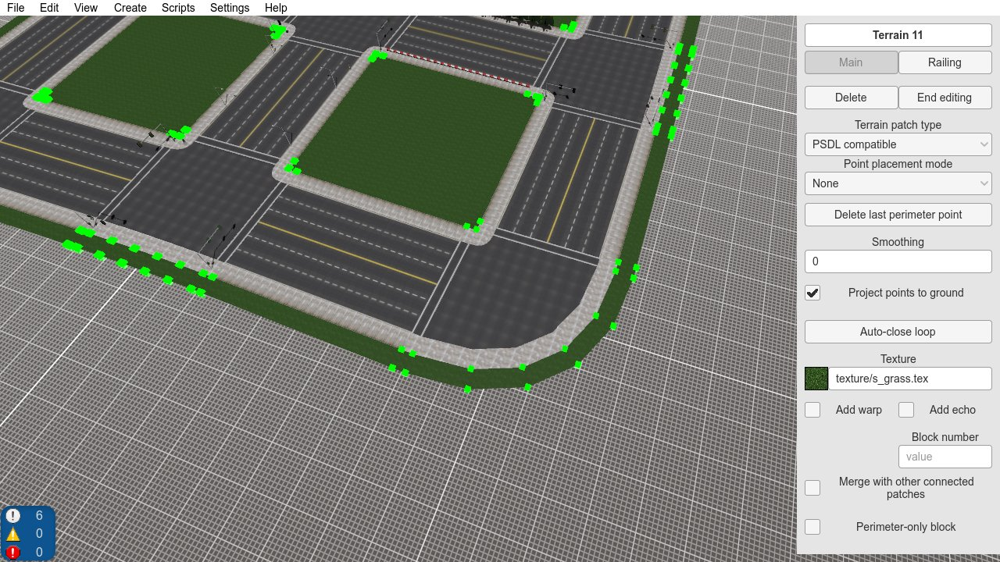

The texture set for a terrain patch is also used for the new patches. Leave the texture blank to create an invisible patch, e.g. as a place for buildings (see [Whole city buildings](#whole-city-buildings)).

By default a terrain patch is optimized for flat terrain. To make it follow a non-flat ground more closely, add internal points to it: select *Internal* in the placement mode dropdown and place the points inside the patch. If the result is too rough, increase *Smoothing* (the number of smoothing iterations). To move perimeter or internal points away from the ground, uncheck *Project points to ground*.

## Buildings

There are two ways to place buildings: procedurally generated *building lines*, described here, or pre-made [meshes](#meshes-and-props).

### Building lines

To create a building line, select *Create→Building line* (or press Ctrl+E), then click on the ground to place the points of the line. Like for terrain patches, you can place these points on the anchors on the sides of roads and terrain patches.

A building line is made of several buildings, separated by *dividing points* (a dividing point marks the end of a building and the start of the next one). You can place them directly (set the placement mode to *Dividing point*), or turn an existing point into a dividing point (set the placement mode to *None*, click on the point and click *Toggle dividing point*).

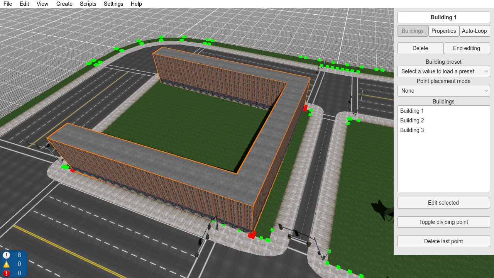

If you move an anchor point connected to an edge containing a building point, the building point moves so that its relative position on the edge stays the same. Hold Ctrl while moving the anchor to keep the building point in place.

To create a single building with a custom shape, check *Front only* and *Loop* in the *Properties* tab of the line, select a roof texture and set the building height.

### Automatic placement

To fill a loop of roads with buildings:

1. Place the first point of the line between two anchor points (the line between them is highlighted in magenta when detected).
2. In the *Auto-Loop* tab, add the building presets to use (select them in the dropdown and click *Add selected*). Each building uses one of them, chosen randomly.
3. Set the minimum and maximum length of the buildings (each length is random in this range), then click *Auto-close loop*.

You can disable the subdivision by length: the dividing points are then placed on the corners with an angle greater than 45 degrees.

### Whole city buildings

After placing the roads and the terrain patches, select *Create→Whole city buildings*, set the same properties as for a single loop plus the building line preset, and click *Create whole city buildings*. You can choose to place them only on invisible terrain patches. The same panel can delete all the buildings.

### Selecting buildings and their parts

Each building of a line has 4 sides (front, back, left and right) and a roof. With no object selected:

- to select a building side, click on it
- to select a building, click on its roof or Ctrl-click any part of it
- to select the whole line, Shift-click any part of it

In the building panel you can change the roof texture, the height and depth of the building, and enable, disable or edit each of its sides.

### Building sides

A building side is made of *floors*, and each floor is made of *blocks*.

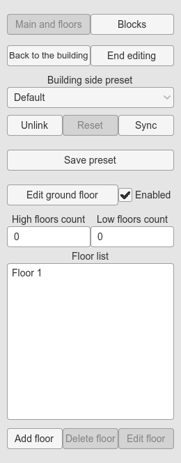

**Blocks** can be of 3 types: empty, texture and sliver. To create one go to the *Blocks* tab, click *Add block*, then select it, click *Edit block*, and select its type and texture. You can also give it a name, to find it more easily in the list.

**Floors** are of two types:

- the ground floor (each building has only one, it can be disabled by unchecking *Enabled*)
- the upper floors (there can be many)

To edit the ground floor click *Edit ground floor*; to add an upper floor click *Add floor*, then select it and click *Edit floor*.

Each floor has its own height, and is made of *slices*: each slice uses a block of the blocks list, has its own width, and can be repeated *n* times. For ground floors, each slice contains 3 blocks: the middle one is the main block, the top and bottom ones are the slivers (use sliver-type blocks only for these two).

The *High floors count* and *Low floors count* parameters control how many of the upper floors are used for the top and the bottom of the building; the remaining ones (the middle ones) are repeated to reach the number of floors of the building. For example, with the floors A, B, C, D, E, F, high/low floor counts of 2 and 2, and a building with 8 floors, the floors are A, B, C, D, C, D, E, F.

## Meshes and props

### Placing meshes

To place a mesh, select *Create→Mesh instance*, select a mesh from the list (you can search it by name), click *Start placement*, then click on the ground to place one or more copies of it.

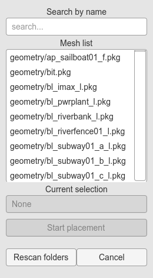

To change the position, rotation or scale of a placed mesh, exit the placement mode (click *Close* or press Escape) and click on the mesh. You can then move it (click *Move* or press W), rotate it (click *Rotate* or press E) and scale it (click *Scale* or press R), or enter the values by hand in the panel. Hold Shift to apply the transforms in incremental steps (e.g. move snapped to the grid).

Some meshes are placed automatically depending on the properties of other objects (depending on the core, e.g. traffic lights at intersections), and some of their transform axes may be locked. The position and rotation you set for them are *relative* to the automatic ones, so moving the parent object keeps your offsets.

### Mass placement

To place many meshes at once, check *Place multiple in radius*, set the *Intensity* and the *Radius*, then click and drag on the ground. Check *Random rotation* to rotate each mesh randomly, or *Delete mode* to delete the meshes instead. The core can define other options.

### Prop rules

Props can also be placed automatically along roads with *prop rules*, in the *Props* tab of the road panel. Prop rules are divided in parts defined by the core (e.g. left, right, middle), each one containing one or more *elements*, which define which meshes to use and how to place them (the details depend on the core).

## City properties and containers

To edit the city-wide properties, select *Edit→City properties*. They include the name of the city and other properties defined by the core (e.g. the traffic light models, or the races).

Some of these properties (depending on the core, e.g. races) contain objects that are only used in a certain context (e.g. the opponents and waypoints of a race). To avoid cluttering the city with objects that are not meant to be used together, the objects of these *containers* are only shown while the container is selected. While a container is selected, a blue entry appears in the menu bar: to deselect and hide it, select *N container(s) selected→Deselect \<container\>*.

## Exporting

To export the city, select *File→Export city*, select the folder where to save it, and click *Save*. For formats other than *JSON*, a dialog with the export options of the core appears.

## Advanced

### Rotating the whole city

*Edit→Rotate city* rotates the whole city by 90 degrees (clockwise or counterclockwise) or 180 degrees.

### Batch update

To change a property of all (or some) the objects of a certain type at once, select *Edit→Batch update*, select the object type, write the update expression and, optionally, the where expression, and click *Execute*. Click *Parameters list* to see the properties available for the selected type.

The update expression has the form `property=value`. You can wrap the value in double quotes to avoid issues with string parsing (e.g. `property="value"`). To change more than one property, join them with `and`: `property1=value1 and property2=value2`.

Make sure that each value matches the type of the property, otherwise things may not work properly:

- *bool*: `True` or `False` (case sensitive)
- *int*: integer values (e.g. `1`, `10`, `123`)
- *float*: decimal values (e.g. `1.0`, `10.4`, `123.456`)
- *string*: any string (e.g. `test1`, `"test2.tga"`)

The where expression selects the objects to update: an object is updated only if the expression is true for it. Use `=` to check for equality and `!=` for inequality, and combine the conditions with `and` and `or` (`and` takes precedence). Some examples:

- `property = value`
- `property != value`
- `property1 = value1 or property2 = value2`
- `property1 = value1 and property2 = value2`
- `property1 = value1 and property2 = value2 or property3 != value3`

## Troubleshooting

The counters in the bottom-left corner of the window show the number of messages, warnings and errors. Click them to open the debug console: any runtime error is reported there, along with its stack trace.

Python errors are saved in the *pythonLog.txt* file in the city builder folder. The Python functions of the cores run in a local Python server. When its debug mode is enabled (in *Settings→Preferences→Python*) the server runs in its own console window, which shows its output instead of the log file: if the server fails to start, disable the debug mode and check the log.
